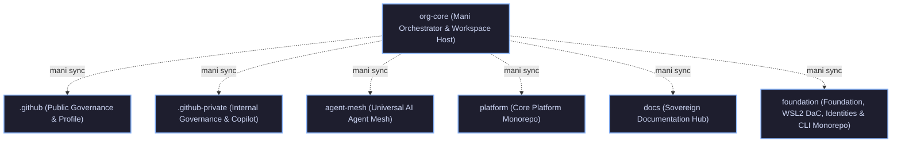
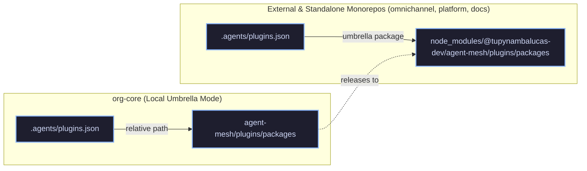

# Umbrella Meta-Repository (`tupynambalucas-dev/org-core`)

Central enterprise orchestrator and unified multi-repository workspace for the `tupynambalucas-dev` organization. This umbrella meta-repository coordinates six sovereign foundation repositories via [Mani](https://manicli.com) and multi-root IDE workspaces, providing unified cross-repository context, navigation, and batch task execution while preserving completely independent Git histories, branches, release cycles, and CI/CD pipelines.

---

## 1. Architecture Overview

`org-core` forms Layer 0 (Enterprise Foundation) of the organization's dual meta-repository topology. Rather than coupling repositories with Git submodules (`160000` gitlinks), `org-core` binds each repository declaratively in [`mani.yaml`](./mani.yaml) with `sync_gitignore: false` and explicit search negation rules in [`.ignore`](./.ignore) and [`.rgignore`](./.rgignore).



---

## 2. Managed Repositories & Navigation

| Repository | Path / Namespace | Branch | Documentation | Agent Context | Purpose |
| :--- | :--- | :--- | :--- | :--- | :--- |
| [`.github`](./.github/README.md) | `.github` | `main` | [`README.md`](./.github/README.md) | [`AGENTS.md`](./.github/AGENTS.md) | Organization-wide governance, community health files, public profile, and IDE templates. |
| [`.github-private`](./.github-private/README.md) | `.github-private` | `main` | [`README.md`](./.github-private/README.md) | [`AGENTS.md`](./.github-private/AGENTS.md) | Member-only profile, enterprise Copilot custom agents, managed AI settings, and internal references. |
| [`agent-mesh`](./agent-mesh/README.md) | `agent-mesh` | `main` | [`README.md`](./agent-mesh/README.md) | [`AGENTS.md`](./agent-mesh/AGENTS.md) | Universal AI agent governance monorepo, 11 domain plugins, 9 MCP servers, and modular skills. |
| [`platform`](./platform/README.md) | `platform` | `main` | [`README.md`](./platform/README.md) | [`AGENTS.md`](./platform/AGENTS.md) | Core domain monorepo hosting Kubernetes GitOps manifests, Cortex AI gateway, studio tools, and corporate services. |
| [`docs`](./docs/README.md) | `docs` | `main` | [`README.md`](./docs/README.md) | [`AGENTS.md`](./docs/AGENTS.md) | Sovereign documentation portal built on Docusaurus v3 with Crowdin localization. |
| [`foundation`](./foundation/README.md) | `foundation` | `main` | [`README.md`](./foundation/README.md) | [`AGENTS.md`](./foundation/AGENTS.md) | Sovereign foundation monorepo hosting WSL2 custom distributions (`distributions/`), developer toolchain & CLI (`tools/`), machine identities and Token Broker (`identity/`), host virtualization (`virtualization/`), and documentation hub (`references/`). |

### Multi-Root IDE Workspace

Open [`tupynambalucas-dev-core.code-workspace`](./tupynambalucas-dev-core.code-workspace) in VS Code or Antigravity IDE to mount all six repositories (`.github`, `.github-private`, `platform`, `docs`, `agent-mesh`, `foundation`) in a unified workspace with integrated Mani tasks.

---

## 3. Environment, Secret & Plugin Governance

### A. Three-Tier Secret Resolution Architecture

The ecosystem resolves development credentials across three cascading tiers so workflows operate seamlessly with or without active cloud sessions:

1. **Process Environment**: Variables exported in the active shell session or injected via `infisical run --projectId <PROJECT_ID> --env dev -- <command>`.
2. **Local and Ancestor `.env` Files**: If environment variables are absent from the shell, sovereign MCP launchers (`scripts/launcher.cjs`) walk up the directory tree to discover `.env` files in the child repository or at the `org-core` root (copied from [`.env.example`](./.env.example)).
3. **Infisical CLI Fallback**: If neither process variables nor `.env` files satisfy required keys, launchers invoke `infisical export` using authenticated Machine Identity credentials or developer login sessions.

### B. Enterprise AI Agent Mesh Dual Consumption Model



| Mode | Environment | Discovery Manifest (`.agents/plugins.json`) | Package Dependency |
| :--- | :--- | :--- | :--- |
| **Meta-Repository Mode** | `org-core` Umbrella IDE Workspace | `agent-mesh/plugins/packages` | None (zero build steps, direct local path resolution) |
| **External Service Mode** | Standalone Repositories (`omnichannel`, `platform`, `docs`) | `node_modules/@tupynambalucas-dev/agent-mesh/plugins/packages` | `@tupynambalucas-dev/agent-mesh` via `catalogs.plugins-stack` |

---

## 4. Getting Started

### Prerequisites

- **Git**: `>= 2.40` (configured with Ed25519 SSH commit signing)
- **Mani CLI**: `>= 0.30` (multi-repository orchestrator)
- **Infisical CLI**: `>= 0.31` (secret management)

Install `mani` on Windows via Scoop (or via the corporate WSL2 distribution `tupynambalucas-dev`):

```powershell
scoop bucket add poldi https://github.com/aliesbelik/poldi
scoop install mani
```

### Workspace Initialization

Clone the umbrella orchestrator and synchronize all six foundation repositories:

```bash
git clone git@github.com:tupynambalucas-dev/org-core.git
cd org-core
mani sync
```

---

## 5. Multi-Repository Operations

| Command | Target Scope | Description |
| :--- | :--- | :--- |
| `mani sync` | All repositories | Clones missing repositories and synchronizes remote configurations declared in [`mani.yaml`](./mani.yaml). |
| `mani run status` | All repositories | Executes `git status -s` across all six managed repositories. |
| `mani run fetch` | All repositories | Executes `git fetch origin --prune` across all managed repositories. |
| `mani run pull` | All repositories | Pulls latest `main` branch updates across all managed repositories. |
| `mani run branch` | All repositories | Displays the active Git branch for every repository in a formatted table. |
| `mani run onboard` | `foundation` | Runs workstation compliance verification via the `gh tl verify` CLI extension. |
| `mani run verify-workstation` | `foundation` | Runs the workstation compliance verification script via `gh tl verify`. |

```bash
# Execute daily multi-repository health checks
mani run status
mani run fetch
mani run pull
mani run branch
```

---

## 6. Governance & Contributing Standards

All contributions across `org-core` and its managed repositories must comply with organizational engineering governance:

1. **Cryptographic Commit Signing**: All Git commits and annotated tags MUST be signed using SSH (`git commit -S -m "..."`). Unsigned commits are rejected by repository rulesets.
2. **Conventional Commits**: Commit messages must follow the Conventional Commits v1.0.0 specification (`<type>(<scope>): <description>`).
3. **Single-Branch GitHub Flow**: Each repository operates independently on `main`. Developers create short-lived branches (`feat/<slug>`, `fix/<slug>`, `docs/<slug>`, `chore/<slug>`), push them, and open Pull Requests against `main`.
4. **Zero-Emoji Invariant**: Emojis are strictly prohibited in commit messages, documentation, code comments, and agent interactions.
5. **Secret Hygiene**: Never commit `.env` files or plaintext credentials; use [`.env.example`](./.env.example) templates and Infisical secret injection.
6. **AI Agent Context**: Autonomous agents operating in this workspace MUST read [AGENTS.md](./AGENTS.md) prior to executing tasks.

---

## 7. License

Licensed under the [Apache License 2.0](./LICENSE). Copyright (c) 2026 tupynambalucas.dev.
