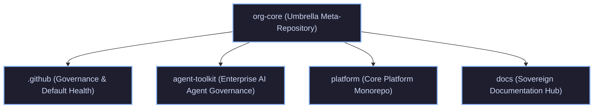

# tupynambalucas-dev Umbrella Meta-Repository

Central orchestrator and unified workspace for the `tupynambalucas-dev` organization.

This umbrella repository links autonomous corporate repositories via Git Submodules, providing unified cross-repository context, navigation, and developer orchestration while preserving independent Git histories, release cycles, and CI/CD pipelines.

---

## Ecosystem Architecture



### Managed Submodules

| Submodule | Target Branch | Purpose |
| :--- | :--- | :--- |
| [`.github`](./.github) | `main` | Organization-wide governance, community health files, public profile, and CI defaults. |
| [`agent-toolkit`](./agent-toolkit) | `main` | Universal AI agent governance plugin, shared MCP connectors, security rules, and skills. |
| [`platform`](./platform) | `develop` | Monorepo hosting Kubernetes manifests, cortex AI gateway, studio tools, and services. |
| [`docs`](./docs) | `develop` | Sovereign documentation portal built on Docusaurus v3 with Crowdin localization. |

---

## Environment Configuration and Secret Governance

The ecosystem implements a 3-tier fallback resolution architecture to ensure development environments operate smoothly whether launched with or without active Infisical sessions:

1. **Process Environment**: Variables already exported in the current shell session or injected via `infisical run`.
2. **Local and Ancestor `.env` Files**: If environment variables are absent from the shell, tools like `scripts/mcp-runner.js` walk up the directory tree to discover `.env` files located in the current workspace or at the `org-core` root.
3. **Infisical CLI**: If neither process variables nor local `.env` files satisfy the requirements, the system invokes `infisical export` using authenticated machine credentials or local login sessions.

### Execution Modes

#### A. Unified Meta-Repository (`org-core`)

When opening the entire `org-core` repository:

- You can maintain a root `.env` file (copied from `.env.example`) to provide shared credentials across all submodules.
- Alternatively, launch your commands or AI agent CLI through Infisical:

```bash
infisical run --projectId <PROJECT_ID> --env dev -- agy
```

#### B. Standalone Workspace Mode

When developing within an isolated submodule directory (`agent-toolkit/`, `platform/`, or `docs/`):

- Each child repository contains its own `.env.example` template.
- Copy `.env.example` to `.env` inside the submodule root to test and execute tools without dependencies on parent repositories.
- Individual submodules can also be run directly with project-scoped Infisical commands:

```bash
# Inside agent-toolkit:
infisical run --projectId <AGENT_TOOLKIT_PROJECT_ID> --env dev -- <command>

# Inside platform:
infisical run --projectId <PLATFORM_PROJECT_ID> --env dev -- <command>
```

---

## Getting Started

### 1. Clone with Submodules

To clone the umbrella repository and all nested submodules in a single pass:

```bash
git clone --recurse-submodules git@github.com:tupynambalucas-dev/org-core.git
cd org-core
```

### 2. Daily Synchronization

Fetch and merge the latest remote commits across all submodules:

```bash
git submodule update --remote --merge
```

To ensure submodules track their target branches rather than a detached HEAD:

```bash
git submodule foreach 'git checkout $(git config -f $toplevel/.gitmodules submodule.$name.branch || echo main)'
```

---

## Development Workflow and Governance

All development in this meta-repository and its submodules must comply with organizational governance:

1. **Cryptographic Signatures**: All Git commits and annotated tags MUST be signed using SSH (`git commit -S -m "..."`). Unsigned commits are rejected by repository rulesets.
2. **Conventional Commits**: Commit messages must follow the Conventional Commits v1.0.0 specification (`feat`, `fix`, `docs`, `chore`, etc.).
3. **Zero-Emoji Policy**: Emojis are strictly prohibited in commit messages, documentation, code comments, and chat responses.
4. **Submodule Pointer Updates**: When committing changes to submodules, stage and commit the updated pointers in `org-core`:

```bash
git add agent-toolkit platform docs .github
git commit -S -m "chore(submodules): bump pointers to latest development heads"
git push origin main
```

---

## License

This meta-repository orchestration configuration is licensed under the [MIT License](https://github.com/tupynambalucas-dev/.github/blob/main/LICENSE).
