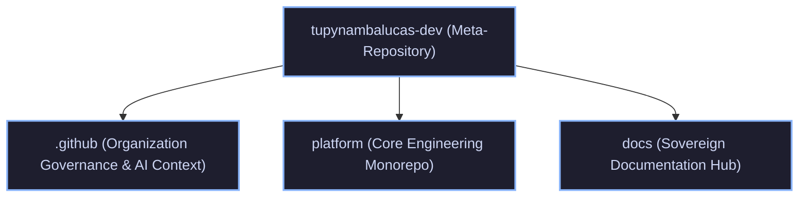

# tupynambalucas-dev Umbrella Meta-Repository

Central orchestrator and unified workspace for the `tupynambalucas-dev` organization.

This umbrella repository links the autonomous corporate repositories via Git Submodules, providing unified cross-repository context, navigation, and developer orchestration while preserving independent Git histories, release cycles, and CI/CD pipelines.

---

## Ecosystem Architecture



### Managed Submodules

| Submodule | Target Branch | Purpose |
| :--- | :--- | :--- |
| [`.github`](./.github) | `main` | Organization-wide governance, AI agent configurations, plugins, and skills. |
| [`platform`](./platform) | `develop` | Monorepo hosting Kubernetes manifests, cortex AI gateway, studio tools, and services. |
| [`docs`](./docs) | `develop` | Sovereign documentation portal built on Docusaurus v3 with Crowdin localization. |

---

## Getting Started

### 1. Clone with Submodules

To clone the umbrella repository and all nested submodules in a single pass:

```bash
git clone --recurse-submodules git@github.com:tupynambalucas-dev/tupynambalucas-dev.git
cd tupynambalucas-dev
```

### 2. Daily Synchronization

Fetch and merge the latest remote commits across all submodules:

```bash
git submodule update --remote --merge
```

To ensure submodules track their target branches rather than a detached HEAD:

```bash
git submodule foreach 'git checkout $(git config -f $toplevel/.gitmodules submodule.$name.branch || echo main)'
```

---

## Development Workflow

1. **Submodule Changes**: Make changes directly within the respective submodule folder (`platform/`, `docs/`, or `.github/`).
2. **Submodule Commits**: Commit and push inside the child repository using its designated branching strategy.
3. **Pointer Updates**: Stage the updated submodule pointers at the root of this meta-repository and commit:

```bash
git add platform docs .github
git commit -m "chore(submodules): bump pointers to latest development heads"
git push origin main
```

---

## License

This meta-repository orchestration configuration is licensed under the [MIT License](https://github.com/tupynambalucas-dev/.github/blob/main/LICENSE).
