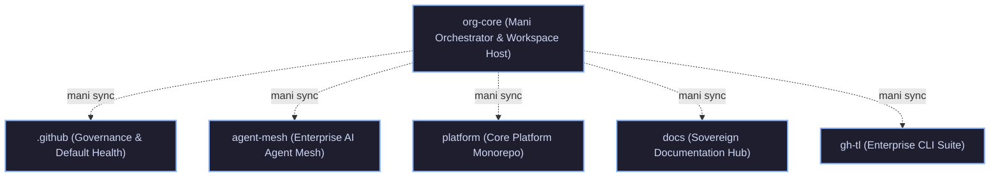

# tupynambalucas-dev Umbrella Meta-Repository

Central orchestrator and unified workspace for the `tupynambalucas-dev` organization.

This umbrella repository orchestrates autonomous corporate repositories via [Mani](https://manicli.com) and multi-root IDE workspaces, providing unified cross-repository context, navigation, and developer orchestration while preserving completely independent Git histories, branches, release cycles, and CI/CD pipelines without Git submodule lockups or detached HEAD hazards.

---

## Ecosystem Architecture



### Managed Repositories

| Repository | Target Branch | Purpose |
| :--- | :--- | :--- |
| [`.github`](./.github/README.md) | `main` | Organization-wide governance, community health files, public profile, and IDE templates. |
| [`agent-mesh`](./agent-mesh/README.md) | `main` | Universal AI agent governance monorepo, shared MCP connectors, domain plugins, and modular skills. |
| [`platform`](./platform/README.md) | `main` | Domain monorepo hosting Kubernetes manifests, Cortex AI gateway, studio tools, and services. |
| [`docs`](./docs/README.md) | `main` | Sovereign documentation portal built on Docusaurus v3 with Crowdin localization. |
| [`gh-tl`](./gh-tl/README.md) | `main` | Enterprise GitHub CLI extension suite for developer onboarding, verification gates, and tooling. |

### Multi-Root IDE Workspace

Open [tupynambalucas-dev.code-workspace](./tupynambalucas-dev.code-workspace) in VS Code or Antigravity IDE to mount all five repositories (`.github`, `platform`, `docs`, `agent-mesh`, `gh-tl`) in a unified workspace with integrated Mani tasks.

---

## Environment Configuration and Secret Governance

The ecosystem implements a 3-tier fallback resolution architecture to ensure development environments operate smoothly whether launched with or without active Infisical sessions:

1. **Process Environment**: Variables already exported in the current shell session or injected via `infisical run`.
2. **Local and Ancestor `.env` Files**: If environment variables are absent from the shell, tools like `agent-mesh/scripts/mcp-gateway-router.js` walk up the directory tree to discover `.env` files located in the current workspace or at the `org-core` root.
3. **Infisical CLI**: If neither process variables nor local `.env` files satisfy the requirements, the system invokes `infisical export` using authenticated machine credentials or local login sessions.

### Execution Modes

#### A. Unified Meta-Repository (`org-core`)

When opening the entire `org-core` repository:

- You can maintain a root `.env` file (copied from `.env.example`) to provide shared credentials across all repositories.
- Launch commands or AI agent CLI through Infisical:

```bash
infisical run --projectId <PROJECT_ID> --env dev -- agy
```

#### B. Standalone Workspace Mode

When developing within an isolated repository directory (`agent-mesh/`, `platform/`, or `docs/`):

- Each child repository contains its own `.env.example` template.
- Copy `.env.example` to `.env` inside the repository root to test and execute tools independently.
- Individual repositories can also be run directly with project-scoped Infisical commands:

```bash
# Inside agent-mesh:
infisical run --projectId <AGENT_MESH_PROJECT_ID> --env dev -- <command>

# Inside platform:
infisical run --projectId <PLATFORM_PROJECT_ID> --env dev -- <command>
```

---

## Getting Started

### 1. Prerequisites

Install `mani` using Scoop:

```powershell
scoop bucket add poldi https://github.com/aliesbelik/poldi
scoop install mani
```

### 2. Clone Workspace and Synchronize Repositories

Clone the umbrella orchestrator and initialize all child repositories:

```bash
git clone git@github.com:tupynambalucas-dev/org-core.git
cd org-core
mani sync
```

### 3. Daily Multi-Repository Operations

Run batch commands across all repositories with zero submodule overhead:

```bash
# Check status across all projects
mani run status

# Fetch remote updates
mani run fetch

# Pull latest main across all projects
mani run pull

# Show active branches
mani run branch
```

---

## Development Workflow and Governance

All development across repositories must comply with organizational governance:

1. **Cryptographic Signatures**: All Git commits and annotated tags MUST be signed using SSH (`git commit -S -m "..."`). Unsigned commits are rejected by repository rulesets.
2. **Conventional Commits**: Commit messages must follow the Conventional Commits v1.0.0 specification (`feat`, `fix`, `docs`, `chore`, etc.).
3. **Zero-Emoji Policy**: Emojis are strictly prohibited in commit messages, documentation, code comments, and chat responses.
4. **Autonomous Single-Branch GitHub Flow**: Each repository operates independently. Developers create feature branches (`feat/<slug>`, `fix/<slug>`), push them, and open Pull Requests against `main`. No submodule pointer bumps or cross-repo pointer synchronization PRs are needed.

---

## License

Licensed under the [Apache License 2.0](./LICENSE). Copyright (c) 2026 tupynambalucas.dev.
